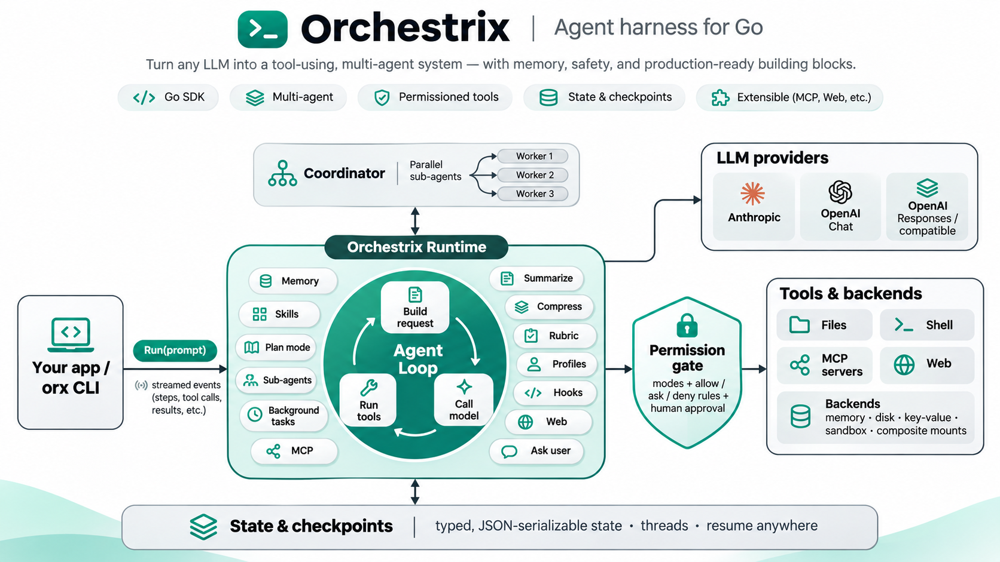

# Orchestrix

[](https://github.com/aswin-kevin/orchestrix/actions/workflows/ci.yml)
[](https://pkg.go.dev/github.com/aswin-kevin/orchestrix)
[](https://goreportcard.com/report/github.com/aswin-kevin/orchestrix)
[](LICENSE)

**An AI agent framework for Go.** Orchestrix is an LLM agent harness SDK that turns Claude, GPT or any OpenAI-compatible model into an autonomous, tool-using agent, with streaming, middleware, permissions and human-in-the-loop approval built in.

You get a production-ready agent loop in a few lines of code, with no dependencies beyond the Go standard library.

> Orchestrix is under active development. Milestones 1 (the core) and 2 (depth) are complete; the API may still change before 1.0.

<p align="center">
  
</p>

Your application starts a run with `orchestrix.New(...)` (or the `orx` CLI) and receives streamed events back. The agent loop builds each request, calls the model, schedules tool calls and appends their results. Middleware wraps the model and tool calls. Every tool call passes the permission gate before it touches a backend, and the whole conversation lives in typed, JSON-serializable state.

## Features

- **Three providers, one interface.** Anthropic Messages, OpenAI Chat Completions and OpenAI Responses, selected with a `format:model` string.
- **Streaming events.** `Run` returns a Go iterator (`iter.Seq2`) of text, tool, usage and interrupt events; the last one always carries the outcome.
- **Middleware.** Every optional behavior (file tools, planning, subagents, summarization, your own hooks) is a middleware wrapping the model call or tool calls.
- **Permissions.** Six modes plus allow, ask and deny rules, evaluated before any tool runs.
- **Pluggable file backends.** In-memory per-thread workspaces or a real directory on disk.
- **Subagents.** The model delegates work to isolated or forked subagents with the `task` tool.
- **Context management.** Long conversations are summarized automatically, and the history stays complete in state.
- **Prompt caching.** Stable prefixes and recent messages are marked for the provider's cache.
- **Hooks.** Run your code before and after tool calls and at the start and end of runs.
- **Human in the loop.** A tool call that needs approval pauses the run; resume it with your decision, even in another process.
- **Checkpoints and threads.** Conversations, and the default workspace, are saved and continued later.
- **Shell and background tasks.** An `execute` tool on a real directory, with long-running jobs the agent can follow.
- **Budgets.** Limit model turns and wall-clock time, and cap output tokens per response; a total token target (`TokenBudget`) is available through `agent.Config` and `WithConfig`.
- **Zero dependencies.** Standard library only.

## Install

```sh
go get github.com/aswin-kevin/orchestrix
```

Requires Go 1.24 or newer.

## Quick start

```go
package main

import (
	"context"
	"fmt"
	"log"

	"github.com/aswin-kevin/orchestrix"
	"github.com/aswin-kevin/orchestrix/agent"
	"github.com/aswin-kevin/orchestrix/permission"
)

func main() {
	a, err := orchestrix.New("anthropic:claude-sonnet-4-5",
		orchestrix.WithSystemPrompt("You are a careful assistant."),
		orchestrix.WithPermissionMode(permission.ModeAcceptEdits),
		orchestrix.WithMaxTurns(20),
	)
	if err != nil {
		log.Fatal(err)
	}

	prompt := "Create /notes/hello.txt saying hello, then read it back."
	for ev, err := range a.Run(context.Background(), orchestrix.Text(prompt)) {
		if err != nil {
			log.Fatal(err)
		}
		switch ev.Kind {
		case agent.KindText:
			fmt.Print(ev.Text)
		case agent.KindToolUse:
			fmt.Printf("\n[tool: %s]\n", ev.ToolName)
		case agent.KindFinal:
			fmt.Printf("\n\nfinished: %s after %d turns, %d output tokens\n",
				ev.Final.Reason, ev.Final.Turns, ev.Final.Usage.Output)
		}
	}
}
```

`orchestrix.New` gives you an agent with file tools (`ls`, `read_file`, `glob`, `grep`, `write_file`, `edit_file`, `multi_edit`, `delete`), a planning tool (`write_todos`), subagents (`task`), context summarization, prompt caching and permission checks already wired. Other options: `WithTools`, `WithMiddleware`, `WithoutMiddleware`, `WithBackend`, `WithAllow`/`WithAsk`/`WithDeny`, `WithApprover`, `WithMaxDuration`, `WithMaxTokens`, `WithWorkingDir`, and the feature options described below (`WithSubagents`, `WithSummarize`, `WithHooks`, `WithInterruptOn`, `WithCheckpointer`, `WithShell`, `WithTasks`). `WithConfig` exposes the full `agent.Config`, and you can build one yourself and call `agent.New` for complete control.

## Providers

The model is a `format:model` string. Only the first colon splits the format, so model names may contain colons.

| Format | Wire protocol | API key | Base URL (optional) |
| --- | --- | --- | --- |
| `anthropic` | Anthropic Messages | `ANTHROPIC_API_KEY` | `ANTHROPIC_BASE_URL` |
| `openai` | OpenAI Chat Completions | `OPENAI_API_KEY` | `OPENAI_BASE_URL` |
| `openai-responses` | OpenAI Responses | `OPENAI_API_KEY` | `OPENAI_BASE_URL` |

```go
orchestrix.New("anthropic:claude-sonnet-4-5")
orchestrix.New("openai:gpt-4o")
orchestrix.New("openai-responses:gpt-4o")
```

Setting `OPENAI_BASE_URL` points the `openai` formats at any compatible server. For full control (proxy, headers, retries, rate limits), build an `llm.Config`, create a provider with `llm.New`, and pass it to `orchestrix.New` instead of a string.

## Middleware

A middleware is any value with a `Name() string` method plus whichever hook interfaces it needs: `BeforeAgent`, `AfterAgent`, `BeforeModel`, `AfterModel`, `BeforeStop`, `ModelWrapper`, `ToolWrapper` and `ToolProvider`. Wrappers nest like an onion: the first middleware in the stack is the outermost, and a wrapper may call `next` zero, one or several times.

The stack order is fixed, outermost first: `summarize`, `cache`, `hooks` (with `WithHooks`), `hitl` (with `WithInterruptOn`), `filesystem`, `planning`, `subagents`, `tasks` (with `WithTasks`). By default that is `summarize`, `cache`, `filesystem`, `planning` and `subagents`. Adding a middleware with a default's name replaces it; `WithoutMiddleware("subagents", "summarize")` removes them. `summarize` rebuilds each request from state, so it must stay first.

A custom middleware that logs every tool call (imports omitted):

```go
type toolLogger struct{}

func (toolLogger) Name() string { return "tool-logger" }

func (toolLogger) WrapTool(ctx context.Context, call *agent.ToolCall,
	next agent.ToolHandler) (tool.Result, error) {
	start := time.Now()
	res, err := next(ctx, call)
	log.Printf("%s took %s (err: %v)", call.Name, time.Since(start), err)
	return res, err
}

a, err := orchestrix.New(model, orchestrix.WithMiddleware(toolLogger{}))
```

An agent is shared by concurrent runs, so keep per-run data in `state.State` (see `state.NewKey`), not in the middleware's fields.

## Permissions

Every tool call is checked before it runs. Choose a mode with `WithPermissionMode`:

| Mode | Behavior |
| --- | --- |
| `default` | Read-only calls run; anything else asks. |
| `acceptEdits` | Also allows file-modifying tools. |
| `bypassPermissions` | Allows everything except what a deny rule forbids. |
| `plan` | Denies everything that is not read-only. |
| `dontAsk` | Never asks; denies whatever is not explicitly allowed. |
| `auto` | Never asks; denies unless a rule or the tool itself allows. |

Rules refine the mode. Deny rules always win, even over `bypassPermissions`, an ask rule asks even for a tool that considers itself safe, and a tool that refuses a call itself is never overridden. A path hidden by a `read(...)` deny or ask rule is also left out of `ls`, `glob` and `grep` results.

```go
// Imports omitted; model comes from surrounding code.
orchestrix.New(model,
	orchestrix.WithAllow("read_file", "write(/notes/**)"),
	orchestrix.WithAsk("delete"),
	orchestrix.WithDeny("write(/secrets/**)", "execute(rm:*)"),
)
```

`execute` exists only with a backend that can run commands, such as the one `WithShell` provides (see below); without one the `execute(rm:*)` rule above has nothing to match.

Rule grammar: `Tool` matches a tool by name, `Tool(pattern)` narrows it by the call's main string (such as a shell command; `git:*` matches `git` followed by arguments), and `read(glob)` / `write(glob)` match file paths. A malformed rule makes `New` return an error. Calls that need approval go to the `WithApprover` callback, or interrupt the run when there is none (see below).

Rules are matched lexically, so know their limits. Path rules are case-sensitive and do not resolve symlinks (the disk backend still refuses paths that resolve outside its root). Command prefix rules do not parse shell syntax: `execute(git:*)` also matches `git status && rm -rf x`. Permissions decide which calls the agent makes; they are not a sandbox.

## Backends

A backend is the file system the file tools operate on.

- **`backend/memory`**: in-memory and safe for concurrent use. This is the default, with one separate workspace per thread ID that lives as long as the agent.
- **`backend/disk`**: a real directory. Paths the model sees are relative to the root, and access outside it is refused.
- **`backend/shell`**: a disk backend that can also run commands; see "Shell and background tasks".

```go
// Imports omitted; model comes from surrounding code.
ws, err := disk.New("./workspace")
if err != nil {
	log.Fatal(err)
}
a, err := orchestrix.New(model, orchestrix.WithBackend(ws)) // shared by all threads
```

Use `WithBackendFactory(func(threadID string) backend.Backend { ... })` to choose a backend per thread. Implement the `backend.Backend` interface to add your own.

## Human in the loop

Without an approver, a tool call that needs approval pauses the run. The final event has reason `interrupted`, and `Final.State` holds everything needed to continue. Answer each pending action with a `Decision` (`Approve`, `Edit`, `Reject` or `Respond`) and call `Resume`:

```go
// Imports omitted; ctx and model come from surrounding code.
a, _ := orchestrix.New(model) // default mode: write_file needs approval

in := orchestrix.Text("Create /todo.txt with three items.")
in.ThreadID = "demo"

var final *agent.Final
var pending *agent.Interrupt
for ev, err := range a.Run(ctx, in) {
	if err != nil {
		log.Fatal(err)
	}
	switch ev.Kind {
	case agent.KindInterrupt:
		pending = ev.Interrupt
	case agent.KindFinal:
		final = ev.Final
	}
}

if final.Reason == agent.ReasonInterrupted {
	answers := bufio.NewScanner(os.Stdin)
	var decisions []agent.Decision
	for _, req := range pending.Requests {
		fmt.Printf("run %s %s? [y/N] ", req.Tool, req.Input)
		answers.Scan()
		d := agent.Decision{ToolUseID: req.ToolUseID, Type: agent.Approve}
		if !strings.EqualFold(strings.TrimSpace(answers.Text()), "y") {
			d.Type, d.Message = agent.Reject, "the user declined"
		}
		decisions = append(decisions, d)
	}
	for ev, err := range a.Resume(ctx, "demo", final.State, decisions) {
		// the same event stream as Run
		_, _ = ev, err
	}
}
```

Pass the same thread ID to `Resume` so the run keeps using the same backend.

`Final.State` can be serialized with `encoding/json` and resumed later. It holds the conversation and run state, not the workspace: to continue in a new process with the files intact, use a checkpointer (see "Checkpoints and threads").

To pause for a human before specific tools regardless of the permission mode, use `WithInterruptOn`; `WithInterruptConfig` narrows the decisions allowed or which calls pause:

```go
// Imports omitted; model comes from surrounding code.
a, err := orchestrix.New(model,
	orchestrix.WithPermissionMode(permission.ModeAcceptEdits),
	orchestrix.WithInterruptOn("delete"), // pause for a human before every delete
	orchestrix.WithInterruptConfig(map[string]hitl.InterruptConfig{
		"write_file": {
			Allowed: []agent.DecisionType{agent.Approve, agent.Reject},
			When: func(_ context.Context, call *agent.ToolCall) bool {
				return strings.Contains(string(call.Input), "/prod/")
			},
		},
	}),
)
_, _ = a, err
```

## Subagents

The default stack gives the model a `task` tool that starts a subagent: a separate run that shares the parent's workspace, streams its events into the parent's, and returns its final answer as the tool result. Two kinds exist.

- **Isolated** subagents (the built-in `general-purpose` one and every spec you add) see only the task description, under their own system prompt. Anything left out of a `Subagent` is inherited from the parent.
- A **fork** continues the parent's own conversation with the task handed over as the result of its `task` call. Its system prompt, tools and history prefix match the parent's, so the provider's prompt cache is reused. A fork cannot delegate further.

A custom subagent that reviews changes read-only (imports omitted):

```go
a, err := orchestrix.New(model,
	orchestrix.WithSubagents(subagents.Subagent{
		Name:           "reviewer",
		Description:    "Reviews a change for bugs and risky edits.",
		SystemPrompt:   "You review code. Report concrete problems with file and line.",
		PermissionMode: permission.ModePlan, // read-only
		MaxTurns:       10,
	}),
)
_, _ = a, err
```

`WithSubagentConfig` controls the rest: `DisableFork`, `DisableGeneralPurpose`, `MaxDepth` (default 2) and the prompts. A spec may also set its own `Tools`, `Middleware`, `Provider`, `Model`, `Rules` and an `OutputSchema` that its final answer must satisfy.

Approvals: with a `WithApprover`, subagents inherit it and ask it directly. Without one, a subagent that needs a decision pauses the parent's `task` call with one request listing the subagent's pending actions; approving or rejecting it applies to all of them, and the subagent then continues. Per-action `edit` and `respond` decisions are not available for a subagent's requests. A subagent's token usage is reported in forwarded usage events and is not added to the parent's `Final.Usage`.

## Context management

The `summarize` middleware keeps long conversations inside the model's context window. The history in state always stays complete; only the request view changes.

- **Automatic compaction.** When a request would pass 85% of the context window, older messages are replaced in the view by a summary, and about the last 25% of the window is kept verbatim. The cut never separates a tool call from its result. The model can also ask for it with the `compact_conversation` tool.
- **Micro-compaction.** Every request clears large results of older tool calls (the newest six are kept) and shortens large old tool inputs.
- **Offload.** Summarized messages are saved under `/conversation_history/<thread>` in the workspace so the model can read them back; this needs a thread ID. Separately, a tool result over 80,000 characters is saved under `/large_tool_results/` and replaced by a head and the path.

```go
// Imports omitted; model comes from surrounding code.
a, err := orchestrix.New(model,
	orchestrix.WithSummarize(summarize.Config{
		TriggerFraction: 0.7,           // compact earlier than the default 0.85
		Model:           "small-model", // summarize with a cheaper model
		DisableOffload:  true,          // do not save old messages to the workspace
	}),
)
_, _ = a, err
```

## Prompt caching

The `cache` middleware asks providers that support prompt caching to cache the stable prefix (the system prompt segments you pass to `WithSystemPrompt`) and to mark the two most recent user messages as breakpoints. Other models are left untouched. Forked subagents share the parent's prefix and so hit the same cache. Remove it with `WithoutMiddleware("cache")`; `cache.Config.Recent` changes the breakpoint count when you add the middleware yourself.

## Hooks

Hooks run your code at fixed points: `PreToolUse`, `PostToolUse`, `PostToolUseFailure`, `UserPromptSubmit`, `SessionStart`, `SessionEnd`, `Stop` and `SubagentStart`. A `PreToolUse` hook runs after the permission rules allowed a call and can block it, rewrite its input or add context to its result. Returning an error that wraps `agent.ErrStopRun` ends the run with reason `hook_stopped`.

```go
// Imports omitted; model comes from surrounding code.
a, err := orchestrix.New(model,
	orchestrix.WithHooks(hooks.Config{
		PreToolUse: []hooks.PreToolUseHook{{
			Matcher: hooks.Matcher{Tools: []string{"write_file", "edit_file"}},
			Fn: func(ctx context.Context, in hooks.ToolInput) (hooks.PreToolUseOutput, error) {
				if bytes.Contains(in.Input, []byte("/secrets/")) {
					return hooks.PreToolUseOutput{Block: true, Reason: "secrets are off limits"}, nil
				}
				return hooks.PreToolUseOutput{}, nil
			},
		}},
	}),
)
_, _ = a, err
```

Hooks for concurrency-safe tool calls of one turn may run concurrently, so synchronize any shared data.

## Checkpoints and threads

With `WithCheckpointer`, the agent saves a thread's state after every change (each reply, each batch of tool results, interrupts and the end of the run). The default in-memory workspace is saved with it, so files survive a restart too. `checkpoint/file` stores one append-only file per thread in a directory; `checkpoint/memory` keeps them in process. A failed save ends the run with reason `checkpoint_error`.

`Agent.Thread` opens a conversation by ID, from its latest checkpoint if there is one. Each `Prompt` continues it, and a pending interrupt can be answered with `Resume`, in the same process or another one that opens the same directory:

```go
// Imports omitted; model comes from surrounding code.
ctx := context.Background()
cp, err := file.New("./checkpoints")
if err != nil {
	log.Fatal(err)
}
a, err := orchestrix.New(model, orchestrix.WithCheckpointer(cp))
if err != nil {
	log.Fatal(err)
}

// The same code, in this process or a later one, continues thread "ticket-42".
th, err := a.Thread(ctx, "ticket-42")
if err != nil {
	log.Fatal(err)
}
if pending, ok := th.Pending(); ok {
	fmt.Println("waiting for a decision on", len(pending.Requests), "action(s)")
}
for ev, err := range th.Prompt(ctx, "Continue where we left off.") {
	if err != nil {
		log.Fatal(err)
	}
	if ev.Kind == agent.KindText {
		fmt.Print(ev.Text)
	}
}
```

Open one `Thread` handle per conversation: two handles on the same ID do not know about each other and overwrite each other's checkpoints. A checkpointed workspace is stored whole in the thread's state, so for large workspaces prefer a disk or shell backend (which `WithCheckpointer` leaves alone).

## Shell and background tasks

`WithShell(root, shell.Options{})` runs the agent on the real directory `root` and adds the `execute` tool. Commands run with a minimal environment, timeouts and output limits; `shell.Options` adjusts them. `WithShell` cannot be combined with `WithBackend` or `WithBackendFactory`, and the one backend is shared by all threads.

`WithTasks` lets `execute` start a command in the background (`run_in_background`) and gives the model `task_output`, `task_stop`, `task_list`, `sleep` and `monitor` to follow it. Finished jobs are announced to the model on its next turn. The host owns the `tasks.Middleware` and must call `Shutdown` to stop jobs still running:

```go
// Imports omitted; model comes from surrounding code.
tm := tasks.New(tasks.Config{})
defer tm.Shutdown() // stops background jobs still running

a, err := orchestrix.New(model,
	orchestrix.WithShell("./workspace", shell.Options{}),
	orchestrix.WithTasks(tm),
	orchestrix.WithAllow("execute(git:*)"),
	orchestrix.WithDeny("execute(rm:*)"),
)
_, _ = a, err
```

Command rules are matched on the parsed command line, not the raw text. An allow rule such as `execute(git:*)` must cover every command in a line, so `git status && rm -rf x` is not allowed by it, while a deny or ask rule applies if it matches any one command. A line the parser cannot vouch for (command substitution, piping into a shell, a leading `VAR=value`, a program run by path) is never allowed by a pattern rule, and when deny or ask rules exist it needs a human even in `bypassPermissions` mode. Rules still name programs, not behavior: an allowed program that runs others can reach anything.

**The shell backend is not a sandbox.** Commands run as your process, with its privileges and, by default, a small allowlist of its environment variables. Run agents that execute untrusted instructions inside a container or VM.

## CLI

`orx` is a small coding-agent CLI built on the SDK. It works in a directory on disk and asks before running tools that need approval.

```sh
go install github.com/aswin-kevin/orchestrix/cmd/orx@latest

export ANTHROPIC_API_KEY=...
orx -model anthropic:claude-sonnet-4-5 -p "Summarize the Go files in this directory"
orx -model openai:gpt-4o            # interactive session; /exit to quit
```

| Flag | Meaning |
| --- | --- |
| `-model` | Model spec `format:model` (default: `$ORX_MODEL`). |
| `-p` | Run this prompt once and exit; without it, start an interactive session. |
| `-yes` | Allow every tool call without asking (`bypassPermissions`). |
| `-mode` | Permission mode name; wins over `-yes`. |
| `-system` | File holding the system prompt. |
| `-dir` | Root directory of the workspace (default `.`). |
| `-max-turns` | Maximum model turns per prompt (default 50). |
| `-base-url` | Override the provider base URL. |
| `-thinking`, `-effort` | Thinking and reasoning-effort settings passed to the provider. |

`orx` exits with status 1 when a prompt does not complete (a model error, a limit such as `-max-turns`, or Ctrl-C) and 2 for usage errors.

## Roadmap

Milestone 1 (core) shipped the three providers, the agent loop with middleware, events and budgets, permissions, memory and disk backends, file and planning tools, the preset and a minimal CLI. Milestone 2 (depth) added subagents (isolated and forked), summarization, prompt caching, hooks, checkpointed threads and resume, a human-approval middleware, the shell backend and background tasks. Next:

- **Milestone 3, knowledge and reach:** memory, skills, MCP, plan mode, deferred tools, web tools, ask-user.
- **Milestone 4, scale:** async runs, a coordinator, rubric evaluation, model profiles, key-value, composite and sandbox backends, context compression, examples and full docs.

## Contributing

Issues and pull requests are welcome. Before sending a change, make sure `gofmt -l .` prints nothing and `go vet ./...` and `go test -race ./...` pass. The live integration test is skipped unless `ORX_TEST_MODEL` is set (for example `ORX_TEST_MODEL=openai:gpt-4o`, optionally with `ORX_TEST_BASE_URL` and `ORX_TEST_API_KEY`).

## License

Apache-2.0. See [LICENSE](LICENSE).
